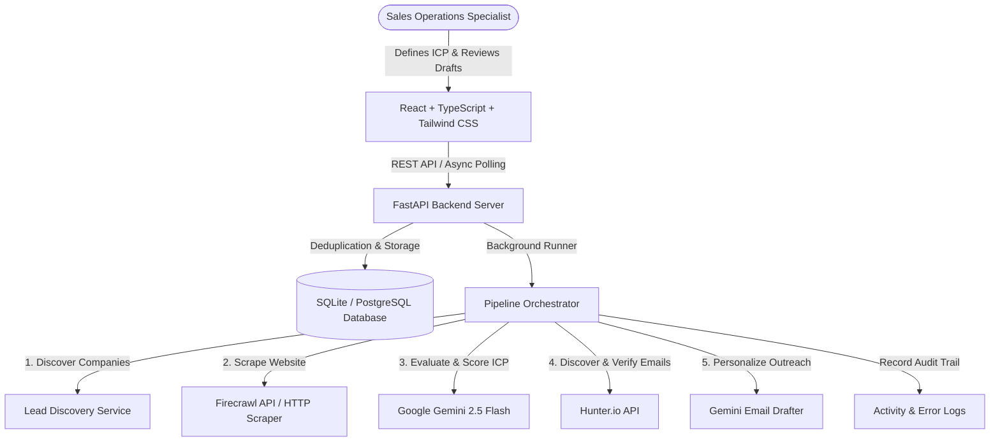

# LeadFlow AI Agent

> **Autonomous Sales Operations & B2B Prospecting Agent**  
> **Author:** Mikiyas Hulualem — Full-Stack AI Web Developer  
> **Specification:** SRS / Solution Design Aligned

[](https://fastapi.tiangolo.com)
[](https://react.dev)
[](https://www.typescriptlang.org/)
[](https://tailwindcss.com)
[](https://ai.google.dev/)
[](https://hunter.io)
[](https://firecrawl.dev)

---

## 1. Executive Summary

LeadFlow AI is an AI-powered sales operations agent designed for small B2B software companies, agencies, and startups. It automates the tedious, multi-step prospecting workflow:
1. **Discovering Potential Customers:** Identifies companies matching targeted ICP (Ideal Customer Profile) criteria.
2. **Website & Business Research:** Scrapes public company pages using Firecrawl to gather concrete evidence and business context.
3. **AI Qualification & Scoring:** Evaluates each prospect against target criteria using Google Gemini, generating an explainable fit score (0–100), key strengths, and potential risks.
4. **Decision-Maker Discovery:** Finds professional emails and confidence scores using Hunter.io.
5. **Personalized Cold Outreach Preparation:** Drafts high-converting, personalized 1-on-1 emails.
6. **Human-in-the-Loop Oversight:** Provides a centralized dashboard for sales professionals to review, edit, and explicitly approve outreach drafts before any message is sent.

---

## 2. System Architecture



---

## 3. Key Features

- **Automated Lead Discovery (FR-01, FR-02):** Define customer criteria (industry, geography, company size, pain points) and crawl matching B2B companies with built-in deduplication (FR-08).
- **Gemini AI Qualification (FR-03):** Returns structured JSON assessments containing a fit score (0–100), executive justification, positive fit factors, and risk caveats.
- **Hunter.io Contact Enrichment (FR-04):** Locates verified decision-maker emails, job titles, and confidence levels.
- **Firecrawl Content Scraper (FR-03):** Extracts readable markdown and meta information from company landing pages.
- **Human-Controlled Outreach (FR-05, FR-07):** In-app draft editor with subject/body modification and explicit approval controls. External autonomous sending is strictly disabled by default.
- **Comprehensive Audit Trail (FR-08):** Complete activity stream tracking run progression, scoring outcomes, and deduplication events.
- **Resilient Fallback Mode:** Operates seamlessly even without paid API keys by providing synthetic demo discovery data and intelligent fallbacks.

---

## 4. Project Structure

```
Brain3.ai/
├── backend/
│   ├── app/
│   │   ├── routes/
│   │   │   ├── activity.py       # Activity logs & audit trail
│   │   │   ├── dashboard.py      # KPI statistics & metrics
│   │   │   ├── discovery.py      # Lead discovery runs
│   │   │   ├── drafts.py         # Outreach review & human approval
│   │   │   ├── leads.py          # Lead explorer, filtering, re-analysis
│   │   │   └── profiles.py       # ICP target customer profiles
│   │   ├── services/
│   │   │   ├── discovery_service.py # Discovery & domain normalization
│   │   │   ├── firecrawl_service.py # Website scraping & fallbacks
│   │   │   ├── gemini_service.py    # Gemini scoring & draft generation
│   │   │   ├── hunter_service.py    # Hunter domain lookup & email verify
│   │   │   └── orchestrator.py      # End-to-end pipeline coordinator
│   │   ├── config.py             # Pydantic v2 application settings
│   │   ├── database.py           # SQLAlchemy engine & session manager
│   │   ├── main.py               # FastAPI entrypoint & CORS
│   │   ├── models.py             # Relational database models (7 entities)
│   │   └── schemas.py            # Pydantic request/response schemas
│   ├── tests/
│   │   └── test_api.py           # PyTest automated test suite
│   ├── requirements.txt          # Python dependencies
│   └── venv/                     # Virtual environment
├── frontend/
│   ├── src/
│   │   ├── components/
│   │   │   ├── ActivityFeedView.tsx   # Audit & execution logs
│   │   │   ├── DashboardView.tsx      # Overview KPIs & quick actions
│   │   │   ├── DiscoveryModal.tsx     # ICP setup & live run tracker
│   │   │   ├── LeadDetailModal.tsx    # Research, AI breakdown & contacts
│   │   │   ├── LeadExplorerView.tsx   # Filterable lead table
│   │   │   ├── Navbar.tsx             # Navigation & service status
│   │   │   └── OutreachReviewView.tsx # Human approval draft editor
│   │   ├── services/
│   │   │   └── api.ts                 # Typed fetch client
│   │   ├── App.tsx                    # Main container application
│   │   ├── index.css                  # Tailwind styles & theme
│   │   └── types.ts                   # TypeScript interfaces
│   ├── package.json
│   ├── tailwind.config.js
│   └── vite.config.ts
├── .env.example
├── .gitignore
└── README.md
```

---

## 5. Getting Started

### Prerequisites
- **Python 3.10+** (tested on Python 3.14)
- **Node.js 18+** & **npm**

### 1. Environment Setup

Copy `.env.example` to `.env`:
```bash
cp .env.example .env
```

Configure your API keys and Gmail SMTP credentials in `.env`:
```env
# AI & Enrichment Services
GEMINI_API_KEY=your_gemini_api_key_here
HUNTER_API_KEY=your_hunter_api_key_here
FIRECRAWL_API_KEY=your_firecrawl_api_key_here

# Gmail SMTP Email Integration
GMAIL_USER=your-email@gmail.com
GMAIL_APP_PASSWORD=your-16-character-app-password
EMAIL_FROM=your-email@gmail.com
SMTP_HOST=smtp.gmail.com
SMTP_PORT=587

# App Settings
DATABASE_URL=sqlite:///./leadflow.db
FRONTEND_ORIGIN=http://localhost:5173
PORT=8000
```

### Gmail SMTP Setup Guide (Google App Password)

To send approved outreach emails from LeadFlow AI using Gmail SMTP:

> [!IMPORTANT]
> **Never use your standard Google account password.** Gmail requires a dedicated 16-character **App Password** for SMTP authentication.

1. **Enable 2-Step Verification:**
   - Go to your [Google Account](https://myaccount.google.com/).
   - Navigate to **Security** on the left menu.
   - Under "How you sign in to Google", turn on **2-Step Verification** if not already enabled.

2. **Generate an App Password:**
   - In your Google Account Security tab, search for or click on **App passwords** (or visit [myaccount.google.com/apppasswords](https://myaccount.google.com/apppasswords)).
   - Enter an app name, e.g., `LeadFlow AI`.
   - Click **Create**. Google will display a 16-character password (e.g., `abcd efgh ijkl mnop`).

3. **Configure Environment Variables:**
   - Set `GMAIL_USER=your-email@gmail.com` in your backend `.env` file.
   - Set `GMAIL_APP_PASSWORD=abcdefghijklmnop` (remove spaces).
   - Set `EMAIL_FROM=your-email@gmail.com` (must match your authorized account).
   - Keep credentials server-side only. Do not commit `.env` to Git or expose credentials to the client.

4. **Verify Connection:**
   - Click the **Test SMTP** button in the top navigation bar to send a test ping to your inbox and confirm connectivity before running campaigns.

### 2. Backend Installation & Startup

```bash
# From project root
python -m venv backend/venv

# Activate virtual environment (Windows PowerShell)
.\backend\venv\Scripts\Activate.ps1

# Install requirements
pip install -r backend/requirements.txt

# Start backend server
python -m uvicorn backend.app.main:app --port 8000 --reload
```
API Documentation will be accessible at: `http://localhost:8000/docs`

### 3. Frontend Installation & Startup

In a separate terminal:
```bash
cd frontend
npm install
npm run dev
```
Open your browser at: `http://localhost:5173`

---

## 6. Running Tests

Run the complete backend automated test suite (covering Acceptance Tests A–F, qualification gates, Hunter verification, duplicate prevention, and Gmail SMTP handling):
```bash
python -m pytest backend/tests/ -v
```

Test the frontend TypeScript compilation and production bundle build:
```bash
cd frontend
npm run build
```

## 7. Functional Requirements Compliance Matrix

| Requirement | Description | Implementation Status & Key Components |
|---|---|---|
| **FR-01** | Define target customer criteria (industry, company type, business characteristics) | ✅ **Implemented**: `TargetProfile` model, `POST /api/target-profiles`, chat query parser, Criteria & Profiles Manager view. |
| **FR-02** | Discover potential companies using public company data and save matching leads | ✅ **Implemented**: Hunter.io domain search, Firecrawl scraping, curated geographical discovery, `POST /api/discovery-runs`, deduplication. |
| **FR-03** | Retrieve company info, use Gemini API to assess suitability, score (0-100), and explain reasoning | ✅ **Implemented**: Firecrawl scraping + Gemini 2.5 Flash `analyze_lead_suitability`, structured fit score, strengths, risks, reason. |
| **FR-04** | Use Hunter.io to find professional emails and verify when permitted | ✅ **Implemented**: `HunterService.search_domain` + `verify_email`, confidence scoring, strict verification threshold (confidence ≥ 80), zero fabricated contacts. |
| **FR-05** | Generate personalized outreach drafts based on company research and qualification | ✅ **Implemented**: `GeminiService.generate_outreach_email` referencing company research, non-hallucinated copy, `OutreachDraft` entity. |
| **FR-06** | Dashboard for viewing, searching, filtering, and managing lead records and statuses | ✅ **Implemented**: `LeadExplorerView.tsx`, search input, status pills (ALL, NEW, QUALIFIED, CONTACTED, UNQUALIFIED, ARCHIVED), in-table status updates. |
| **FR-07** | Review, edit, and approve outreach drafts before any email is sent | ✅ **Implemented**: `OutreachReviewView.tsx` with draft subject/body editor, `approveDraft` (marks APPROVED), explicit Gmail SMTP send modal with idempotency. |
| **FR-08** | Detect duplicate leads and maintain records of automation runs, results, and errors | ✅ **Implemented**: Deduplication gate by domain/name, `AutomationRun` model (tracks discovered/qualified/drafts), `ActivityLog` audit feed (`ActivityFeedView.tsx`). |
| **FR-09** | Identify overdue follow-ups and display them in the dashboard | ✅ **Implemented**: `GET /api/dashboard/stats` calculates overdue follow-ups, `GET /api/leads/overdue`, interactive Overdue Alert widget with quick rescheduling. |
| **FR-10** | Support scheduled lead-discovery runs where deployment environment permits | ✅ **Implemented**: `SchedulerService` in-process background worker, `DiscoverySchedule` model, `/api/schedules` CRUD + instant trigger, automated periodic runs. |
| **FR-11** | Provide performance summaries (leads discovered, qualified leads, drafts prepared) | ✅ **Implemented**: `DashboardView.tsx` KPI grid, total leads, qualified leads, fit rate %, drafts under review, approved drafts, sent emails via SMTP. |

---

## 8. REST API Endpoints

| Method | Endpoint | Description |
|---|---|---|
| `GET` | `/api/health` | Service health and integration status |
| `POST` | `/api/chat` | Autonomous 8-step pipeline execution and criteria parsing |
| `GET` | `/api/dashboard/stats` | High-level metrics, overdue follow-ups, and activity feed (FR-09, FR-11) |
| `POST` | `/api/target-profiles` | Create new ICP target profile (FR-01) |
| `GET` | `/api/target-profiles` | List saved target profiles |
| `POST` | `/api/discovery-runs` | Start asynchronous discovery run |
| `GET` | `/api/discovery-runs/{id}` | Poll discovery run status & counts |
| `GET` | `/api/leads` | Search and filter leads (status, score, overdue) (FR-06) |
| `GET` | `/api/leads/overdue` | List leads with overdue follow-up touchpoints (FR-09) |
| `GET` | `/api/leads/{id}` | Full lead details with research & contacts |
| `PATCH` | `/api/leads/{id}` | Update lead fields or status |
| `POST` | `/api/leads/{id}/analyze` | Trigger re-analysis with Gemini (FR-03) |
| `POST` | `/api/leads/{id}/draft` | Generate personalized email draft (FR-05) |
| `POST` | `/api/leads/{id}/reschedule-followup` | Reschedule follow-up touchpoint date & notes |
| `GET` | `/api/drafts` | List outreach drafts (DRAFT / APPROVED / SENT) |
| `PATCH` | `/api/drafts/{id}` | Edit email subject or body (FR-07) |
| `POST` | `/api/drafts/{id}/approve` | Approve draft for human outreach (FR-07) |
| `POST` | `/api/drafts/{id}/send` | Send approved email via Gmail SMTP (idempotent, schedules follow-up) |
| `POST` | `/api/drafts/test-email` | Explicit test email dispatch to verify Gmail SMTP credentials |
| `GET` | `/api/schedules` | List recurring discovery schedules (FR-10) |
| `POST` | `/api/schedules` | Create new periodic lead discovery schedule (FR-10) |
| `PATCH` | `/api/schedules/{id}` | Update or toggle active status of schedule (FR-10) |
| `DELETE` | `/api/schedules/{id}` | Delete discovery schedule |
| `POST` | `/api/schedules/{id}/trigger` | Trigger immediate discovery run for schedule (FR-10) |
| `GET` | `/api/activity` | Retrieve execution logs and audit trail (FR-08) |

---

## 9. Deployment

- **Frontend:** Deploy to [Vercel](https://vercel.com) connecting the `frontend` directory.
- **Backend:** Deploy to [Render](https://render.com) using `uvicorn backend.app.main:app --host 0.0.0.0 --port $PORT`.
- **Database:** Supabase PostgreSQL (simply set `DATABASE_URL=postgresql://postgres:...` in Render environment variables).

---

## 10. License

MIT License. Developed for Brain3.ai.

